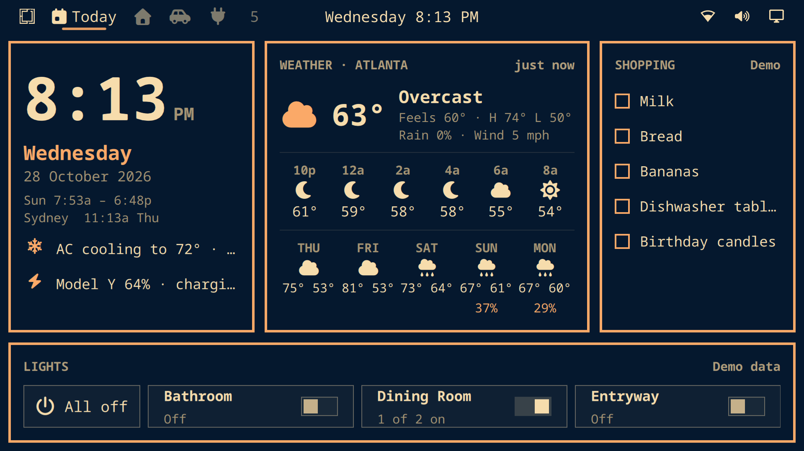
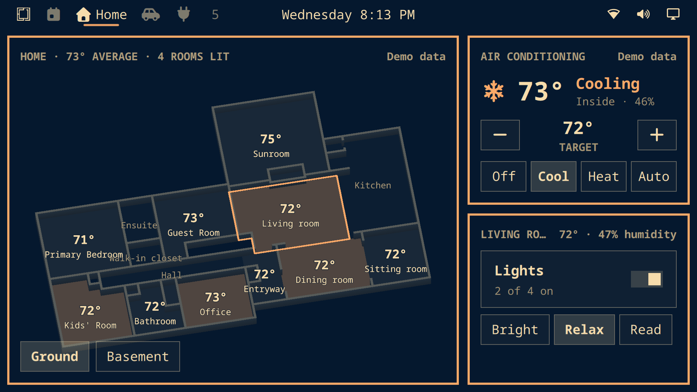
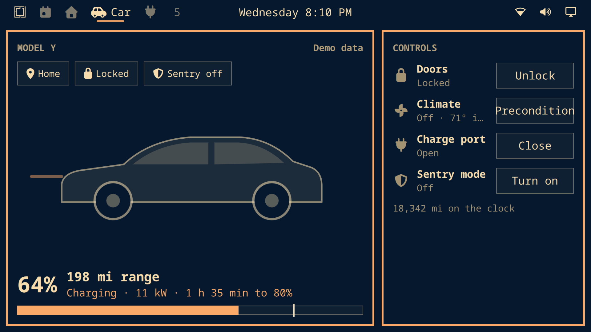
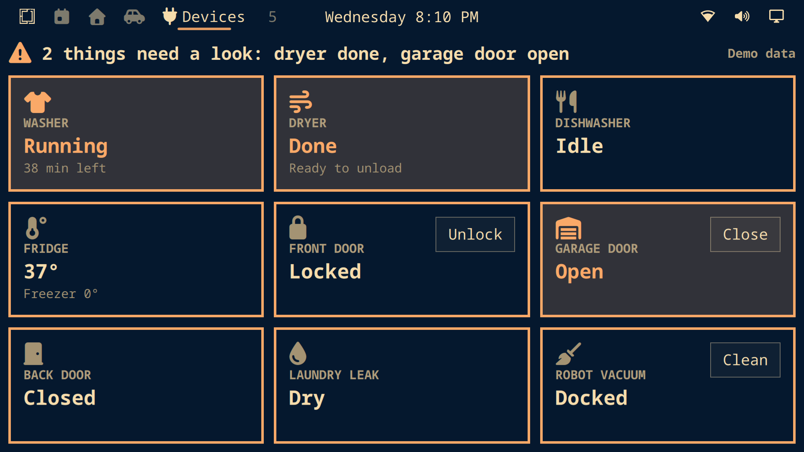

# framarchy

Omarchy (Arch Linux ARM + Hyprland) on a Frameo "DPF Frame 157" photo frame:
Rockchip RK3326, 1 GB RAM, 32 GB eMMC, 1920x1080 panel behind a Lontium
LT8911EXB DSI→eDP bridge.

**Status: in progress.** See [PLAN.md](PLAN.md) for the stages and what has
been verified on hardware. Android package and power settings have been changed
over ADB; no replacement OS or boot image has been flashed. See the
[operations log](docs/operations.md) for changes and recovery commands.

## Dashboard

The frame runs a touch home dashboard as an Omarchy shell plugin: weather,
Home Assistant lights and climate on a 3D floor plan, the car, and appliances.
See [dashboard/README.md](dashboard/README.md) and
[docs/dashboard.md](docs/dashboard.md).

| | |
| --- | --- |
|  |  |
|  |  |

Screenshots from the frame in demo mode, with an altered floor plan.

## Layout

| Path | What |
| --- | --- |
| [docs/hardware.md](docs/hardware.md) | Hardware and eMMC layout read from the stock firmware |
| [docs/recovery.md](docs/recovery.md) | Restoring the stock firmware from the backup (maskrom) |
| [docs/operations.md](docs/operations.md) | Dated device changes, verified results, backup status and Android recovery commands |
| [docs/boot-design.md](docs/boot-design.md) | First-boot scope, alternatives and verification criteria |
| [research/](research/) | Cited research: RK3326 mainline support, Omarchy on aarch64 |
| [scripts/backup-emmc.sh](scripts/backup-emmc.sh) | Verified read-only eMMC backup over root ADB |
| [scripts/backup-loader.py](scripts/backup-loader.py) | Resumable offline eMMC backup, with two matching reads per chunk |
| [scripts/build-recovery-tools.sh](scripts/build-recovery-tools.sh) | Builds `rkdeveloptool` and the RK3326 maskrom loader on macOS |
| [scripts/fetch-rootfs.sh](scripts/fetch-rootfs.sh) | Downloads and verifies the Arch Linux ARM aarch64 rootfs |
| [scripts/build-kernel.sh](scripts/build-kernel.sh) | Builds the mainline kernel + DTBs in Docker |
| [kernel/](kernel/) | Kernel config fragment, patches (LT8911EXB driver), board DTS |
| [port/](port/) | Omarchy installer for the frame (pinned commit, low-RAM settings, touch keyboard) |
| [dashboard/](dashboard/) | Home dashboard plugin for the Omarchy shell |
| `backup/`, `build/` | Local only (gitignored): firmware backup, sources, build output |

## Requirements

- macOS on Apple Silicon with Homebrew and Docker (Docker Desktop or OrbStack)
- A USB-A → USB-C **data** cable (USB-C ↔ USB-C does not enumerate on these frames)
- About 40 GB free disk for the backup

## Procedure

1. **Enable ADB on the frame.** Settings → About → Beta program, then enable
   ADB. Connect the cable and accept "Allow USB debugging" (toggle ADB off and
   on if the prompt does not appear).
2. **Back up the eMMC.**
   ```sh
   brew install android-platform-tools
   scripts/backup-emmc.sh backup/frame157
   ```
   Completed files are checked against a SHA-256 computed on the frame.
   A live Android disk can change during a copy. For the recovery image,
   stop Android with `adb -s HF4A62I77N reboot loader`, then run:
   ```sh
   python3 scripts/backup-loader.py
   ```
   This reads each chunk twice before assembling the full image under
   `backup/frame157-loader/`. Keep a second copy of the completed backup elsewhere.
3. **Build the recovery tools** and confirm maskrom works before writing
   anything: `scripts/build-recovery-tools.sh`, then see
   [docs/recovery.md](docs/recovery.md).
4. **Build the system.**
   ```sh
   scripts/fetch-rootfs.sh
   scripts/build-kernel.sh
   ```
5. **Install Omarchy** on the booted frame, as user `frame`:
   ```sh
   git clone <this repo> ~/framarchy && ~/framarchy/port/bootstrap.sh
   ```

Steps between 4 and 5 (board DTS, boot image, writing it to the frame) are
being developed; see PLAN.md.

## Credits

The Omarchy port approach and several files in `port/` come from
[pangoleen/ormarch-picture-frame](https://github.com/pangoleen/ormarch-picture-frame)
(MIT, see [port/NOTICE](port/NOTICE)). The LT8911EXB register sequences come
from Lontium's reference driver.
