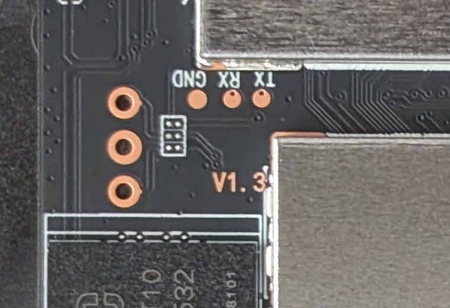

# Debug console

The board is a C-Link **`CL-RK3326-DP105F` V1.3** (sticker: `DP105F 1+32
2.4GWIFI M15R5 20251106`). There is no published schematic. Board photos:
[front](img/board-front.jpg), [back](img/board-back.jpg).

## Console pads



The SoC side of the board (front photo) has three labelled test pads,
**GND, RX, TX**. They sit just below the Wi-Fi module's shield, left of the SoC
shield and the "V1.3" mark. The labels are from the frame's side:

| Pad | USB-UART adapter |
| --- | --- |
| TX | RX |
| RX | TX |
| GND | GND |

- Use **3.3 V logic**, and never connect the adapter's VCC.
- The adapter must handle **1,500,000 baud**. CP2102N, CH340C/CH343 and FT232R
  do; the original CP2102 tops out at 921,600.
- Solder thin wires, or hold pogo pins on the pads. Three round through-holes
  to the left are unlabelled, so don't assume they're the same signals.

```sh
ls /dev/tty.usbserial* /dev/tty.wchusbserial* /dev/tty.SLAB* 2>/dev/null
screen /dev/tty.usbserial-XXXX 1500000      # quit: Ctrl-A then K
```

Open the terminal first, then power the frame on. The loader, U-Boot and the
kernel's `earlycon` print here. Stock Android turns its console
(`fiq-debugger`) off once it has booted. If nothing appears, swap TX and RX.

## Which UART this is

The stock console is UART2: `earlycon=uart8250,mmio32,0xff160000`,
`fiq-debugger` serial-id 2, 1,500,000 baud, pin group `uart2m0-xfer`
(GPIO1_D2 = TX, GPIO1_D3 = RX). On the RK3326 those same two pins are also the
SD slot's DAT0 and DAT1 (U-Boot `arch/arm/mach-rockchip/px30/px30.c`). The
pads are almost certainly on those nets. To check with the frame powered off,
test continuity from the TX pad to the SD socket's DAT0 contact.

Two consequences:

- **No soldering needed:** an SD-card breakout in the slot reaches the same
  signals. On a full-size SD card those are DAT0 (contact 7, frame TX),
  DAT1 (contact 8, frame RX) and VSS (contact 3 or 6).
- **The kernel can silence it:** when the SD controller probes, it moves the
  pins back to SD. To keep the console through the whole boot, the board DTS
  must enable `&uart2` with `pinctrl-0 = <&uart2m0_xfer>` and disable `&sdmmc`.
  `kernel/dts/rk3326-frame157.dts` currently does the opposite.

## Other useful board features

- **UPDATE button** (back, next to the USB-A port): this is Rockchip's
  recovery key. Hold it while powering on to enter Loader mode
  (`rkdeveloptool ld` → `Loader`), without needing Android or `adb reboot loader`.
- **RST button** (back, bottom right): hard reset.
- **IR/UART connector** (back, 3-pin JST beside PWR, next to through-holes
  labelled `IR-IN G VCC`): this is not the boot console. The stock DT's only
  other enabled serial port is UART1 (`ttyS1`, GPIO1_C0/C1 with CTS), which
  looks like a Bluetooth-style port. The IR receiver is `remotectl-pwm` on
  PWM0 (GPIO0_B7). So this connector most likely carries IR-IN, ground and a
  supply rail. Measure it before connecting anything, and keep the adapter
  off its VCC pin.
